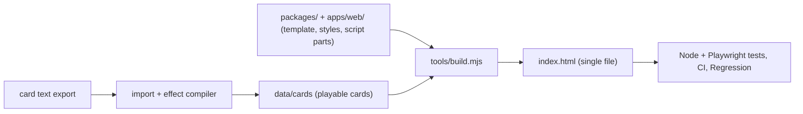

# Aeterna

A fan-made, single-file web simulator for a trading card game. You play against a CPU. It runs on PC and phone with no install.

## What it does
- Play a full match against the CPU on PC (playmat layout) or phone (stacked layout), from one HTML file with no install and no network.
- Card pool: all 8,709 cards (Saga 1-17 and Standard block A) load from a compact built-in pack; the cards whose effects are wired and tested are playable (count below).
- Deck builder with filters, cost curve, ready-made decks and format legality.
- Standard (the default) and Eternal (preview: most Eternal cards are still partial) formats with the ban list, and the ten official Standard starter decks; the rules follow the official manuals, with sources and open points tracked in `docs/manual-notes.md`.
- Data-driven rules engine: card effects are data (triggers, actions, conditions), compiled from card text and checked by tests.
- Seeded matches and replays: any match can be replayed from its seed and inputs; a CPU-vs-CPU fuzzer hunts rare bugs.

Card images are not included; you can import your own in the game (Library).

## Status
Current build: **v0.178.0** (6,894 of 8,709 cards playable, 963 complete). Download `aeterna-v0.178.0.html` from the [latest release](https://github.com/odinguard009/aeterna-experiment/releases/latest) and open it in Chrome or Edge; release notes are in [CHANGELOG.md](CHANGELOG.md).

Next: card sessions that add the mechanics unlocking the most cards, alternating with the move to a TypeScript workspace (server and online play later). Open items: [`docs/ai/roadmap-open.md`](docs/ai/roadmap-open.md); progress page: [`docs/progress.html`](docs/progress.html); mind map: [`docs/roadmap.html`](docs/roadmap.html).

Planned UI languages: English (now), then Japanese, Thai and Chinese.

## Architecture

Build, runtime, effect engine, card data pipeline, compiler, tests and tooling: [`docs/ARCHITECTURE.md`](docs/ARCHITECTURE.md).

## Development
Only Node 20+, Playwright and TypeScript are needed (no npm packages to install). `index.html` is generated: edit `packages/` or `apps/web/`, then build.
```
node tools/build.mjs     # build index.html
npm run -s loop          # build + lint + smoke tests + changed test files
npm test                 # unit + property tests
```
Docs index: [`docs/README.md`](docs/README.md). Working agreement for AI sessions: [`CLAUDE.md`](CLAUDE.md). Bugs and planned work: GitHub Issues.

This repository starts at v0.57.0 with one snapshot commit (2026-10-17); the earlier history stays in the owner's private archive.

## Disclaimer
Unofficial non-commercial fan project; card names, text and trademarks belong to their owners.
